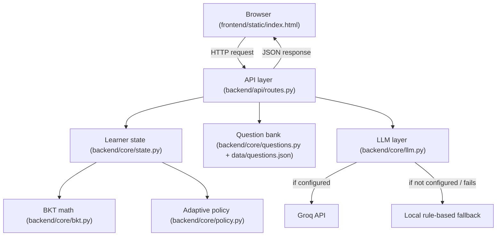
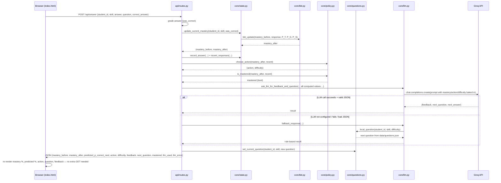

# Primer — Adaptive AI Tutor

A small working prototype of an adaptive tutoring loop:

**historical answers → learner-knowledge estimate → teaching decision → LLM-delivered feedback and next question**

This README exists so a new collaborator can understand the *entire* data flow and
know exactly which file is responsible for which step, without reading all the code
first.

---

## 1. The five-layer mental model

Every request to this app passes through five conceptually separate layers, in this order:



| Layer | Owns | Does NOT own |
|---|---|---|
| **API** (`api/routes.py`) | Parsing HTTP requests, calling the other layers in the right order, shaping JSON responses | Any BKT math, any policy logic, any LLM prompt text |
| **Mastery / BKT math** (`core/bkt.py`) | The pure probability formulas (Bayesian update, guess/slip correction, prediction) | State, memory, I/O — it's stateless, same inputs always give same outputs |
| **Session state** (`core/state.py`) | "What do we currently believe this student knows, right now" — in-memory dictionaries | The math itself (delegates to `bkt.py`) |
| **Adaptive policy** (`core/policy.py`) | Mastery number → what should happen next (teach / practice / advance) | Mastery calculation, question content |
| **Questions** (`core/questions.py` + `data/questions.json`) | Storing and selecting which question to show | Grading, mastery |
| **LLM communication** (`core/llm.py`) | Turning computed state into a human-readable message, generating the next question's *text*, falling back gracefully | Deciding what the learner knows or what action to take — the LLM is told these numbers, never computes them |

**The one rule that holds the whole architecture together:**
the LLM is a *communicator*, never a *decider*. Mastery, the action, and the
difficulty are always computed by `bkt.py` + `policy.py` **before** the LLM is
ever called. `llm.py`'s prompt explicitly instructs the model not to override
these values.

---

## 2. Folder structure

project_root/
├── test.py # standalone Groq connectivity check — run this first if LLM calls fail
├── .env # GROQ_API_KEY, GROQ_MODEL (not committed)
├── .env.example # template for the above
├── requirements.txt
├── data/
│ ├── student_interactions.csv # historical evidence — what actually happened, read-only
│ └── questions.json # question bank, keyed by skill → difficulty → [question, answer]
├── frontend/
│ └── static/
│ └── index.html # entire UI: markup + CSS + JS in one file, talks to the backend via relative fetch() calls
└── backend/
├── app.py # Flask app creation + static file serving ONLY — no business logic
├── config.py # single source of truth: paths, BKT parameters, env vars, skill order
├── core/
│ ├── data.py # reads student_interactions.csv
│ ├── bkt.py # bkt_update(), predict_correct() — pure math, no state
│ ├── state.py # SESSION_STATE, SESSION_HISTORY — current learner state per (student, skill)
│ ├── policy.py # choose_action(), is_mastered(), next_skill()
│ ├── questions.py # loads questions.json, serves/cycles questions, tracks CURRENT_QUESTION
│ └── llm.py # Groq client, prompt construction, JSON parsing, offline fallback
└── api/
└── routes.py # all Flask routes — the only file that talks to every other layer


---

## 3. What "state" actually means here

Two different kinds of truth exist side by side, and conflating them was an
earlier bug in this project (the state used to reset after every answer because
it was recalculated from the CSV each time):

| | Source | Mutable? | Lives in |
|---|---|---|---|
| **Historical evidence** | `student_interactions.csv` | No — read-only, past interactions | `core/data.py` |
| **Current learner state** | In-memory, built once from CSV then updated live | Yes — updates on every answered question | `core/state.py` → `SESSION_STATE` |

`state.get_current_mastery()` is the only place these two meet: it reads CSV
history **once** (`historical_mastery()`) to seed `SESSION_STATE`, and every
subsequent question in that session updates `SESSION_STATE` directly — the CSV
is never touched again. This is also why **a server restart currently loses all
session progress** — nothing is written back to persistent storage yet (see
Known Gaps).

---

## 4. Full request lifecycle: submitting an answer

This is the most important flow in the app — read this once and the rest of
the codebase follows the same pattern.



**Key design point:** after `/api/answer` responds, the frontend does **not**
call `/api/state` again — the answer response already contains everything
needed to re-render (new mastery, new predicted probability, new question).
Calling `/api/state` afterward would be redundant and is deliberately avoided
in the JS (see the comment in `submitAnswer()`).

### The other endpoints, briefly

| Endpoint | Purpose | Touches |
|---|---|---|
| `GET /api/students` | Populates the student dropdown | `core/data.py` only |
| `GET /api/state` | Initial load / skill switch — current mastery, prediction, active question | `state.py`, `bkt.py`, `policy.py`, `questions.py` |
| `POST /api/answer` | The main loop — grade, update mastery, decide next action, get feedback | all core modules |
| `POST /api/chat` | Free-form Q&A grounded in current state, never changes mastery | `state.py`, `policy.py`, `llm.py` |
| `POST /api/reset` | Clears all in-memory state and question-cycling counters | `state.py`, `questions.py` |

---

## 5. The BKT model (what `bkt.py` is actually doing)

Hidden state: whether the student **knows** the skill — never directly observed.
Observed: whether their answer was **correct** — which can be misleading
(guessing, slipping).

`bkt_update()` does two things per answer:
1. Bayesian correction of belief using the observed response, guess rate, and slip rate.
2. Applies the learning-transition probability (chance of moving from not-knowing to knowing).

`predict_correct()` is a *separate* step: it converts the current mastery belief
into "probability the **next** answer will be correct," passing it through the
same guess/slip lens. Mastery and predicted-correctness are related but not
identical numbers — see the mastery-vs-prediction distinction worked out with
hand calculations in this project's earlier learning notes.

Current parameters (`config.py`) are **manually chosen, not fit from data**:

P(L0) = 0.30 initial knowledge
P(T) = 0.20 learning transition rate
P(G) = 0.20 guess rate
P(S) = 0.10 slip rate


---

## 6. The adaptive policy (`policy.py`)

Pure threshold logic on the mastery number — no ML here, just interpretable rules:

mastery < 0.40 → TEACH / REMEDIATE (easy)
0.40 ≤ mastery < 0.70 → PRACTICE (easy)
0.70 ≤ mastery < 0.85 → PRACTICE (medium)
mastery ≥ 0.85, last wrong → REVIEW / CHECK UNDERSTANDING
mastery ≥ 0.85, last 2 ✓ → MASTERED / ADVANCE (hard)
mastery ≥ 0.85, otherwise → PRACTICE / CONFIRM MASTERY


The "last two correct" guard exists specifically so one lucky high-mastery
guess doesn't flip the system into declaring mastery. These thresholds are
prototype/demo decisions — not validated educational cutoffs.

---

## 7. Setup & run

```bash
# one-time setup
python -m venv .venv
source .venv/bin/activate        # or .venv\Scripts\activate on Windows
pip install -r requirements.txt
cp .env.example .env             # then fill in GROQ_API_KEY

# sanity-check the LLM key BEFORE touching the app
python test.py

# run the app
cd backend
python app.py
# → open http://127.0.0.1:5000
```

If `test.py` fails, the bug is in your key/network — fix that before
debugging `app.py`. If `test.py` passes but `/api/answer` still shows
`llm_used: false`, the app still works correctly: it falls back to
`core/llm.py`'s rule-based `fallback_response()` automatically.

---

## 8. Known gaps (intentional, not bugs)

- **No persistence of live answers.** `/api/answer` updates `SESSION_STATE` in memory only — a server restart loses all session progress. `student_interactions.csv` is read-only historical seed data, never appended to.
- **BKT parameters are manual, not fit.** `P(L0)/P(T)/P(G)/P(S)` are fixed guesses in `config.py`, the same for every student and skill.
- **No evaluation layer yet.** There's no accuracy/log-loss/Brier-score check on whether `predict_correct()` is actually well-calibrated against real outcomes.
- **Question bank is small and static.** `data/questions.json` has a handful of hand-written questions per skill/difficulty; `questions.py` just cycles through them.

These are the next layers to build, in roughly this order: persistence →
parameter fitting → evaluation → larger/generated question bank.